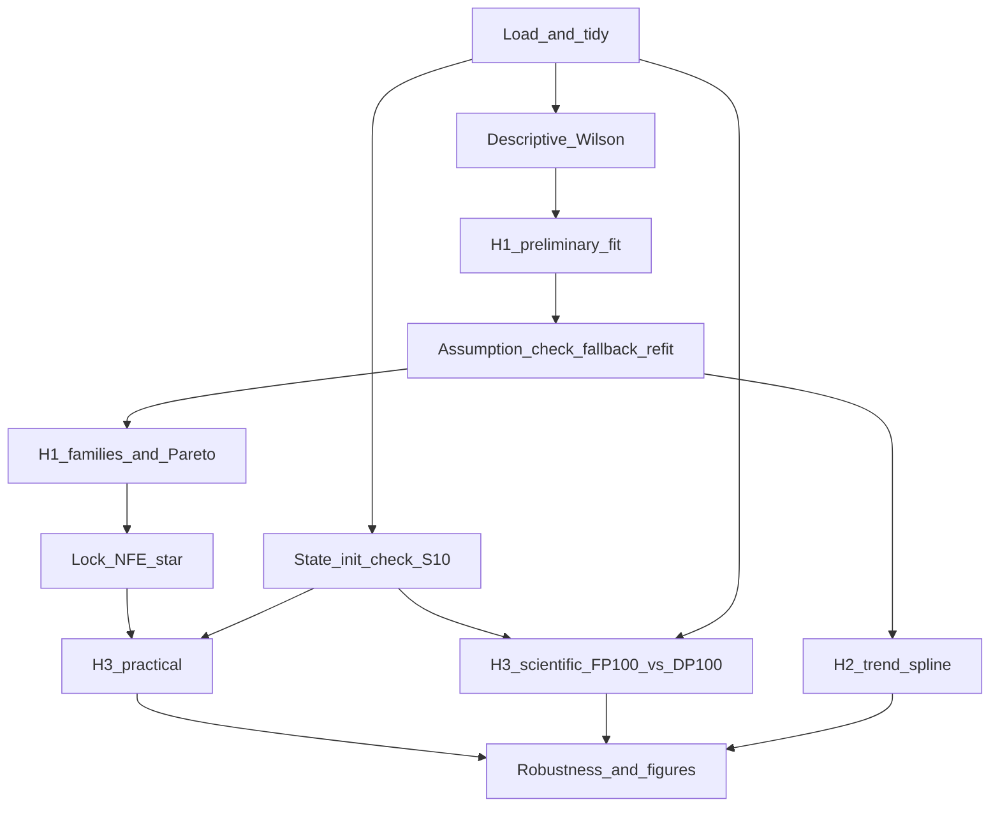

# Rencana Analisis Statistik

**Judul penelitian:** Analisis Komparatif FlowPolicy dan Diffusion Policy pada Lingkungan Simulasi Franka Kitchen

**Versi:** Final (K1–K10 + S1–S10)  
**Bahasa:** Narasi Indonesia; nama fungsi, library, dan istilah statistik tetap dalam bahasa Inggris  
**Status:** Siap direview ahli statistik sebelum implementasi kode

---

## 0. Keputusan desain yang terkunci dari bukti repo

Sebelum spesifikasi uji, keputusan berikut sudah dikunci berdasarkan inspeksi data di `data/kitchen_eval_nfe100/` dan kode terkait. Keputusan ini **tidak boleh diubah post-hoc** setelah melihat hasil uji formal.

| Keputusan | Isi | Bukti singkat |
|-----------|-----|----------------|
| H2 cakupan | Hanya **NFE** yang estimable sebagai prediktor inferensi | 99 run FP = 33 NFE × 3 seed; `n_action_steps=4`, `horizon=4` konstan; `noise_scale=1.0`, `sigma_var=0.0` hardcoded |
| Latensi | Dual-level: agregat episode + raw per-call | `eval_metrics.json` (episode) + `notation.npz` (`ell_ms`, `lambda_ms`) |
| Episode RE | **Crossed** `(1\|episode_idx)` setelah verifikasi state | `init_idx` 0..99 aligned antar NFE/seed/model (index); state-level = blocker H3 |
| Seed H1/H2 | `(1\|seed_id)` dengan `seed_id` ∈ {0,1,2} ↔ 42/43/44 | FP only |
| Seed H3 | `(1\|run_id)` dengan `run_id = model_seed_id` | Baseline/DP juga 3 replicate (`train0/1/2`); **bukan** shared `seed_id` |
| H1 reference family | **NFE=32** (pre-specified) | Bukan saturation fit data-driven |
| Pareto | Trade-off murni, **tanpa** hard latency threshold | Tidak ada requirement deployment X ms yang di-pre-specify |
| Wilson CI | Reuse `scripts/kitchen_eval_stats.py` | Sumber kebenaran interval proporsi |

**Larangan eksplisit (jangan dilakukan saat eksekusi):**

1. Shared `(1|seed_id)` pada model H3 multi-arsitektur.  
2. Plateau reference yang dipilih dari saturation fit / data snooping.  
3. Uji formal latensi **per call** antar model dengan action horizon berbeda.  
4. Heckman selection sebagai “solusi” primer untuk durasi.  
5. GEE / cluster-robust SE biasa sebagai inferensi utama dengan 3 cluster.  
6. All-pairwise C(33,2)=528 sebagai family Holm H1.

---

## 1. Ringkasan eksekutif

Pendekatan statistik utama adalah **generalized linear mixed model (GLMM) binomial logit** untuk metrik sukses biner dan **linear mixed model (LMM)** pada skala log untuk metrik latensi kontinu, keduanya dengan struktur random effect yang mencerminkan desain evaluasi: episode pengujian memakai `init_idx` yang sama antar konfigurasi (**crossed** random intercept episode), serta replikasi pelatihan (seed / run). Untuk H1 dan H2 (FlowPolicy saja) dipakai `(1|seed_id) + (1|episode_idx)`. Untuk H3 (multi-model) dipakai `(1|run_id) + (1|episode_idx)` agar seed antar arsitektur tidak disalahartikan sebagai grup yang sama. Karena hanya terdapat 3 cluster tingkat pelatihan, inferensi kontras utama dilengkapi **wild cluster bootstrap** (Cameron–Gelbach–Miller), dengan caveat degrees of freedom efektif ≈ 2. Proporsi agregat dilaporkan dengan **Wilson score interval** (reuse `kitchen_eval_stats.wilson_interval`). Seleksi NFE terbaik (H1) memakai **Pareto frontier** success vs total inference latency tanpa hard threshold, dengan tie-break pra-terdefinisi. Multiple comparisons dikoreksi **Holm** dalam family kontras yang sudah ditentukan sebelum melihat hasil (bukan all-pairwise).

### Tabel uji per hipotesis

| Hipotesis | Metrik | Model utama | Omnibus | Post-hoc / family | Effect size | CI |
|-----------|--------|-------------|---------|-------------------|-------------|-----|
| H1 | `success_p4`, unconditional k1–k3 | GLMM logit: `~ C(NFE) + (1\|seed_id) + (1\|episode_idx)` | LRT / Wald | Holm: vs NFE=1; vs NFE=32; trend log-NFE; (opsional adjacent) | OR + AME; Nakagawa R²; ICC | Wilson (agregat); wild boot (kontras) |
| H1 | Latensi call / per-action / total (FP) | LMM: `log(y) ~ C(NFE) + (1\|seed_id) + (1\|episode_idx)` | LRT / Wald | Holm pada family yang sama | Rasio geometric mean; ICC | Wild boot; median + bootstrap |
| H1 | Durasi subtask \| sukses | Deskriptif + hurdle pelengkap | — | — | — | CI deskriptif + caveat selection |
| H1 | Pilih NFE* | Pareto + tie-break | — | — | — | — |
| H2 | Keenam metrik vs NFE | Tren `log(NFE)` + B-spline; RE sama H1 | Wald / LRT spline | Sensitivitas with/without NFE=100 | AME sepanjang NFE; Nakagawa R² | Wild boot / ribbon spline |
| H2 | AH, noise_scale, sigma_var | **Non-estimable** (varian nol) | — | Laporkan sebagai konstanta | — | — |
| H3 praktis | Success; latensi per-action & total | GLMM/LMM: `~ C(model) + (1\|run_id) + (1\|episode_idx)`† | LRT / Wald | Holm: FP* vs tiap model lain | OR + AME; Nakagawa R² | Wilson; wild boot cluster=`run_id` |
| H3 ilmiah | Success; latensi comparable | FP100 vs DP100 (subset) | Sama | Kontras tunggal / family kecil | OR + AME | Sama |
| H3 | Latensi per call antar model | Deskriptif saja | — | — | — | — |
| H3 | Durasi \| sukses | Hurdle / deskriptif + caveat | — | — | — | — |

† Episode crossed hanya jika verifikasi **state-level** `init_idx` lulus (S10); jika gagal → `(1|model:episode_idx)` atau fallback non-crossed yang didokumentasikan.

---

## 2. Skema data dan preprocessing

### 2.1 Sumber data

| Sumber | Path tipikal | Isi |
|--------|--------------|-----|
| Ringkasan run + episode | `data/kitchen_eval_nfe100/<model>/.../eval_metrics.json` | Success, latensi agregat per episode, `task_durations_ms`, `init_idx` |
| Latensi per call | `.../notation.npz` | `ell_ms`, `lambda_ms`, `episode_idx`, `k_index` |
| Helper CI | `scripts/kitchen_eval_stats.py` | `wilson_interval`, timing methodology |

**Cakupan konfigurasi yang dianalisis**

- FlowPolicy: NFE ∈ {1,…,32, 100}, seed ∈ {42, 43, 44} → 99 run × 100 episode.  
- Diffusion Policy (CNN / Transformer): NFE=100, 3 seed (`train0/1/2`).  
- Baseline: LSTM-GMM, Implicit Behavior Cloning, Behavior Transformer — masing-masing 3 seed.

### 2.2 Format long / tidy

#### `df_episode` (unit analisis primer H1–H3)

| Kolom | Tipe | Keterangan |
|-------|------|------------|
| `model` | str | `flowpolicy`, `diffusion_policy_cnn`, … |
| `nfe` | int | Function evaluations saat inferensi |
| `seed_raw` | str/int | Label asli (`42` atau `train0`) |
| `seed_id` | int | 0, 1, 2 dalam model |
| `run_id` | str | `f"{model}_{seed_id}"` — **wajib untuk H3** |
| `episode_idx` | int | 0..99 |
| `init_idx` | int | Index initial state (harusnya = `episode_idx` pada data saat ini) |
| `success_p4` | 0/1 | Empat subtask berurutan sukses (kumulatif) |
| `success_k1`, `success_k2`, `success_k3` | 0/1 | Unconditional: sukses mencapai ≥1 / ≥2 / ≥3 subtask |
| `success_cond_k2`, `success_cond_k3`, … | 0/1 atau NA | Conditional: sukses di posisi k \| reached k |
| `task_success_<name>` | 0/1 | Sukses named task (microwave, kettle, …) |
| `mean_inference_latency_ms` | float | Mean latensi per `predict_action` dalam episode |
| `mean_latency_per_executed_action_ms` | float | Latensi per aksi yang dieksekusi |
| `total_inference_compute_ms` | float | Jumlah latensi call dalam episode |
| `task_duration_<name>_ms` | float/NA | Hanya terisi jika task sukses |
| `n_replans` | int | Jumlah call dalam episode |
| `log_lat_call`, `log_lat_action`, `log_lat_total` | float | `log(y)` setelah cek y>0 |

#### `df_call` (sensitivitas latensi)

| Kolom | Tipe | Keterangan |
|-------|------|------------|
| `model`, `nfe`, `seed_id`, `run_id` | — | Identitas run |
| `episode_idx` | int | Nested dalam episode |
| `call_idx` / `k_index` | int | Urutan replan |
| `ell_ms` | float | Latensi per call |
| `lambda_ms` | float | Latensi per executed action chunk |
| `log_ell`, `log_lambda` | float | Transformasi |

### 2.3 Definisi success subtask (wajib eksplisit)

Dua definisi menjawab pertanyaan berbeda dan **tidak boleh dicampur** dalam satu family uji yang sama tanpa catatan.

1. **Unconditional**  
   - `success_k`: indikator kumulatif “setidaknya k subtask selesai dalam episode”.  
   - `success_k4` **identik dengan** `success_p4` → **jangan diduplikasi** sebagai metrik terpisah dalam family yang sama.  
   - Analisis primer untuk posisi 1–3 memakai unconditional; posisi 4 dilaporkan hanya sebagai `success_p4`.

2. **Conditional**  
   - P(sukses pada posisi/task k | episode mencapai kesempatan k).  
   - Non-independen antar k (k+1 hanya teramati jika k sukses / reached).  
   - Analisis pelengkap: **GLMM terpisah per k**, bukan satu multivariate joint tanpa struktur kumulatif.
  - Conditional success dianalisis per k, tetapi n efektif menyusut seiring k. Jika success_k1 < 0.7, conditional analyses di k≥3 harus diperlakukan eksploratori saja, bukan uji formal.

**Rekomendasi pelaporan:** tabel utama = unconditional k1–k3 + `success_p4`; lampiran / pelengkap = conditional rates.

### 2.4 Perlakuan NFE: kategorik vs kontinu vs spline

| Coding | Kapan dipakai | Konsekuensi |
|--------|---------------|-------------|
| `C(NFE)` kategorik (33 level) | **Primer H1** (dan kontras H1) | Estimasi fleksibel tiap NFE; banyak parameter; pairwise harus dibatasi family pra-terdefinisi; **tidak** mengasumsikan jarak seragam antara 32 dan 100 |
| `log(NFE)` kontinu | **Primer tren H2**; sensitivitas H1 | Satu koefisien tren; NFE=100 berpengaruh leverage tinggi → sensitivitas with/without 100 |
| B-spline pada `log(NFE)` | Nonlinier / plateau deskriptif + H2 | Menangkap saturasi; **bukan** dasar memilih reference Holm |

**Aturan:** NFE=100 tetap level kategorik di H1. Pada tren kontinu, selalu laporkan sensitivitas mengecualikan NFE=100 agar tidak menginterpolasi lompatan 32→100 secara linier palsu.

### 2.5 Missing data — khususnya durasi subtask

- `task_duration_*` **hanya teramati jika task/subtask sukses** → missingness bergantung pada outcome sukses (seleksi), bukan MCAR.  
- **Dilarang:** imputasi mean/median seolah MCAR; menghapus episode gagal lalu membandingkan durasi antar model seolah sampel acak yang sama.  
- **Heckman selection model tidak dipakai sebagai solusi primer:** tidak identifiable tanpa exclusion restriction yang masuk akal pada desain ini. Sebutkan di limitasi bahwa Heckman dipertimbangkan dan ditolak.  
- **Yang dilakukan:**  
  - Analisis formal utama pada success dan latensi episode (lengkap untuk semua episode).  
  - Durasi: deskriptif + **hurdle** pelengkap (lihat §3) + caveat selection bias.

### 2.6 Outlier latensi

1. Hitung IQR per `(model, nfe)` pada skala mentah dan log.  
2. **Flag** observasi di luar `[Q1 − 1.5·IQR, Q3 + 1.5·IQR]` — jangan otomatis dibuang.  
3. Analisis primer: `log(y)` (meredam skew ekstrem).  
4. Sensitivitas: (a) tanpa outlier terflag; (b) winsorize di batas IQR.  
5. Jangan andalkan z-score pada distribusi latensi yang sangat skewed.

### 2.7 Transformasi

- Latensi: `log(y)` setelah memastikan `y > 0`. Jika ada nol (seharusnya tidak untuk timed call), investigasi artefak timing.  
- Laporkan skewness/kurtosis sebelum dan sesudah log.  
- Quantile regression (median) sebagai sensitivitas jika residual log masih berat ekor.

### 2.8 Konsistensi antar seed

- Hitung success rate dan mean log-latensi per `(nfe, seed_id)`.  
- ICC dari mixed model (proporsi varians `seed_id` / `run_id`).  
- Forest plot per seed: arah efek NFE harus konsisten secara kualitatif.  
- **Jangan** drop seed yang “aneh” tanpa protokol pra-terdefinisi; laporkan sebagai heterogenitas.

### 2.9 Hyperparameter inferensi non-NFE

Nilai tetap pada eksperimen utama (laporkan di metode):

| HP | Nilai tetap | Status analisis |
|----|-------------|-----------------|
| Action horizon / `n_action_steps` (FP) | 4 | Non-estimable sebagai prediktor |
| `noise_scale` | 1.0 | Non-estimable |
| `sigma_var` | 0.0 | Non-estimable |
| Seed | faktor stokastik / RE | Estimable sebagai varians, bukan “efek HP” kausal |

`kripsy12/results.csv` (random search training) **bukan** data H2 utama; boleh disebut di lampiran eksplorasi terpisah.

---

## 3. Analisis per hipotesis

### 3.0 Definisi family untuk multiple comparisons

**Family** = himpunan semua kontras yang **pra-terdefinisi** dalam **satu metrik** dan **satu hipotesis**.

- Koreksi primer: **Holm** dalam family.  
- Sensitivitas: Benjamini–Hochberg FDR.  
- Setiap tabel pairwise wajib memuat **family size** dan nama family.  
- **Dilarang** sebagai family H1 utama: all-pairwise antar 33 NFE (528 kontras).

#### Family H1 (contoh `success_p4`; mirror untuk metrik yang diuji formal)

| Family ID | Kontras | Size | Reference |
|-----------|---------|------|-----------|
| H1-SR-vs1 | Setiap NFE ∈ {2..32,100} vs NFE=1 | 32 | NFE=1 |
| H1-SR-vs32 | Setiap NFE ∈ {1..31,100} vs **NFE=32** | 32 | **NFE=32** (pre-specified; **bukan** saturation fit) |
| H1-SR-trend | Uji tren linier pada `log(NFE)` | 1 | — |
| H1-SR-adj | Adjacent: (1v2),…,(31v32), (32v100) | 32 | — (family terpisah, opsional) |

Justifikasi reference NFE=32: batas atas sweep dengan jarak satuan seragam; NFE=100 diperlakukan sebagai titik ekstrem terpisah. Plot saturasi/spline adalah **deskriptif**, tidak menentukan reference Holm.

#### Family H3 (primer)

| Family ID | Kontras | Size |
|-----------|---------|------|
| H3-SR-vsFP | FP(NFE*) vs tiap model pembanding | ≈5 |
| H3-SR-allpair | Semua pasangan model | Sensitivitas saja |

### 3.1 H1 — NFE FlowPolicy dengan trade-off terbaik

#### 3.1.1 Model statistik utama

**Success (episode-level):**

```text
glmm: success ~ C(NFE) + (1|seed_id) + (1|episode_idx)
family: binomial(logit)
```

**Latensi (episode-level, FP only — action horizon konstan):**

```text
lmm: log(y) ~ C(NFE) + (1|seed_id) + (1|episode_idx)
y ∈ {mean_inference_latency_ms, mean_latency_per_executed_action_ms, total_inference_compute_ms}
```

**Call-level (sensitivitas):**

```text
lmm: log(ell_ms) ~ C(NFE) + (1|seed_id) + (1|episode_idx) + (1|seed_id:episode_idx)
```

#### 3.1.2 Justifikasi model

- Episode nested sederhana `(1|seed_id/episode_idx)` **salah** jika `init_idx` sama antar NFE: kesulitan episode adalah faktor silang → butuh **crossed** `(1|episode_idx)`.  
- ANOVA / regresi OLS pada episode tanpa clustering mengabaikan ketergantungan dalam seed dan within-episode correlation → SE terlalu kecil.  
- GLMM logit cocok untuk biner; LMM pada log cocok untuk latensi skewed positif.

#### 3.1.3 Omnibus

- Bandingkan model penuh `C(NFE)` vs null tanpa NFE: **likelihood ratio test** jika konvergen; jika tidak, **Wald** pada efek NFE.  
- Laporkan juga AIC/BIC sebagai deskriptif, bukan penentu utama.

#### 3.1.4 Post-hoc

- Estimasi kontras via desain matrix / emmeans-equivalent di Python.  
- p-adjusted: **Holm** dalam family (§3.0).  
- Tukey HSD **tidak** dipakai sebagai primer untuk 33 level tidak seimbang secara substantif (NFE=100 ekstrem).

#### 3.1.5 Effect size

| Metrik | Effect size |
|--------|-------------|
| Success | Odds ratio (OR); **average marginal effect / risk difference (AME)**; Nakagawa–Schielzeth marginal R² (fixed) & conditional R² |
| Latensi | Rasio geometric means (= exp(Δ pada skala log)); Cohen's d pada skala log sebagai sekunder |
| Struktur | Variance components crossed (lihat catatan di bawah) |

**Catatan OR:** pada success rate tinggi (0.7–0.9), OR mudah over-dramatize; **selalu** laporkan AME di samping OR.

**Nakagawa R² (GLMM binomial):** gunakan varian **trigamma** (Johnson 2014) atau **delta** (Nakagawa 2017); laporkan varian yang dipakai di caption tabel. Jika `performance::r2_nakagawa` tersedia via R, gunakan itu sebagai sumber kebenaran; jika tidak, implementasi manual dengan formula trigamma.

**Variance components (bukan ICC tunggal):** untuk model crossed, laporkan variance components (σ²_seed, σ²_episode, σ²_residual) dan **proporsi varians** (σ²_seed / total, σ²_episode / total). Jangan klaim “ICC” tunggal — istilah ICC hanya tepat untuk struktur strictly nested.

#### 3.1.6 Confidence interval

- Proporsi agregat (per NFE, pool atau per seed lalu rata-rata): **Wilson**. CI Wilson pada proporsi yang dipool lintas seed bersifat **deskriptif; bukan inferensi formal**. Inferensi formal untuk kontras menggunakan wild cluster bootstrap.  
- Parameter model / kontras: profile likelihood jika tersedia; jika cluster-kecil → **wild cluster bootstrap** (cluster = `seed_id`, B ≥ 999, Rademacher, bootstrap-t).  
- Latensi skewed: laporkan juga median episode + bootstrap CI.

#### 3.1.7 Cara menyimpulkan NFE terbaik (Pareto)

**Pra-syarat (S9):** Tidak ada hard latency threshold deployment. Pemilihan NFE* adalah **trade-off murni**. Jika di masa depan ada threshold X/Y yang ditetapkan *sebelum melihat hasil*, NFE pelanggar dikeluarkan dari kandidat frontier dan amandemen dicatat.

**Prosedur:**

1. Untuk tiap NFE, hitung estimasi `success_p4` (mean over seed atau marginal from GLMM) dan biaya latensi primer = mean/median `total_inference_compute_ms` (sensitivitas: `mean_latency_per_executed_action_ms`).  
2. Bangun **Pareto frontier**: NFE tidak didominasi (success lebih rendah atau sama **dan** latensi lebih tinggi atau sama).  
3. **NFE=100 dimasukkan** ke perhitungan frontier, ditandai sebagai titik ekstrem.  
4. Jika >1 NFE di frontier, tie-break berurutan (pra-terdefinisi):  
   1. `success_p4` tertinggi;  
   2. jika masih seri → **NFE terendah**;  
   3. skor utilitas sekunder saja: \(U = 0.7\,\hat{z}(\mathrm{success}) - 0.3\,\hat{z}(\mathrm{latency})\) dengan \(w=0.7\) (prioritas task completion) — **bukan** pengganti Pareto.  
5. NFE* hasil prosedur ini mengunci cabang **H3 praktis**.

#### 3.1.8 Durasi subtask pada H1

- Deskriptif per NFE di antara episode sukses.  
- Hurdle pelengkap: logit success + log-normal duration | success.  
- Caveat wajib: perbandingan durasi antar NFE **confounded** oleh perbedaan success rate (NFE dengan success lebih tinggi memasukkan episode yang lebih sulit).

### 3.2 H2 — Hubungan hyperparameter inferensi terhadap keenam metrik

#### 3.2.1 Yang estimable

Hanya **NFE** (plus struktur RE seed/episode). Seed adalah sumber stokastisitas, dilaporkan via ICC / analisis per-seed, bukan “tuning HP” kausal.

#### 3.2.2 Model tren

```text
glmm: success ~ log(NFE) + (1|seed_id) + (1|episode_idx)
```

**Spline (spesifikasi konkret):**

```python
# Primer: 3 knots pada skala log-NFE
from patsy import dmatrix
# knots at log(4), log(12), log(24)
bs = dmatrix(
    "bs(log_nfe, knots=(1.3863, 2.4849, 3.1781), degree=3, include_intercept=False)",
    data,
)

# Sensitivitas: 4 knots log(3), log(8), log(16), log(32)
# + with/without baris NFE==100
```

Justifikasi knots: menutupi rise awal, wilayah mid, dan high-NFE sebelum lompatan ke 100.

#### 3.2.3 Interaksi antar HP

Interaksi NFE × action horizon × noise × sigma **tidak diestimasi** pada data utama (varian HP lain = 0). Klaim interaksi = overclaim; tulis di limitasi.

#### 3.2.4 Metrik latensi dan success

Mirror H1: GLMM untuk biner; LMM log untuk latensi; durasi dengan caveat selection.

### 3.3 H3 — FlowPolicy(NFE*) vs Diffusion Policy vs baseline

#### 3.3.1 Dua framing wajib (jangan digabung klaimnya)

| Framing | Kontras | Klaim yang diizinkan |
|---------|---------|----------------------|
| **Praktis (deployed)** | FP(NFE*) vs DP(NFE=100) vs LSTM-GMM / IBC / BeT (dan DP variant yang ada) | “Sistem mana lebih baik saat dipakai?” |
| **Ilmiah (arsitektur @ NFE sama)** | **FP(NFE=100) vs DP(NFE=100)** | Satu-satunya dasar klaim keunggulan arsitektur pada NFE setara |

Baseline konvensional beroperasi sebagai kebijakan non-iterative (efektif NFE=1 by design). **Jangan** mengklaim mereka kalah/menang “pada NFE yang sama” dengan FP/DP.

#### 3.3.2 Model (setelah S10 lulus)

```text
glmm: success ~ C(model) + (1|run_id) + (1|episode_idx)
lmm:  log(y) ~ C(model) + (1|run_id) + (1|episode_idx)
```

dengan `y` hanya **`mean_latency_per_executed_action_ms`** atau **`total_inference_compute_ms`**.

**Jika state-level init gagal:** ganti episode term menjadi `(1|model:episode_idx)` atau laporkan H3 formal terbatas + deskriptif; dokumentasikan sebagai blocker.

**Dilarang:** `success ~ C(model) + (1|seed_id) + ...` dengan `seed_id` 0/1/2 yang dipakai bersama antar model.

#### 3.3.3 Latensi antar model

| Metrik | Perlakuan H3 |
|--------|----------------|
| `mean_latency_per_executed_action_ms` | Uji formal |
| `total_inference_compute_ms` | Uji formal |
| `mean_inference_latency_ms` (per call) | **Deskriptif saja** (FP `n_action_steps=4` vs DP `=8` → call tidak comparable) |

Alasan: satu call DP menghasilkan lebih banyak aksi; membandingkan per-call bias terhadap model dengan horizon lebih pendek.

#### 3.3.4 Post-hoc H3

- Primer: FP* vs tiap pembanding, Holm, family size ≈ 5.  
- All-pairwise antar model: sensitivitas.  
- Wild cluster bootstrap: **cluster = `run_id`**.

#### 3.3.5 Durasi H3

Sama seperti K8: hurdle atau deskriptif; caveat bahwa model dengan success lebih tinggi tampak “lebih lambat” karena episode sulit masuk sampel sukses. Heckman ditolak sebagai solusi primer.

---

## 4. Pengecekan asumsi

### 4.1 Urutan eksekusi asumsi (wajib)

```text
Deskriptif → fit preliminary → cek asumsi → fallback jika perlu → refit → kontras / family final
```

Asumsi **tidak** dicek sebelum ada model terfit.

### 4.2 Asumsi per kelas model

| Model | Asumsi | Cara cek di Python | Jika dilanggar |
|-------|--------|--------------------|----------------|
| LMM | Residual ≈ normal | QQ plot + visual inspection (primer untuk n besar); Shapiro hanya untuk agregat level seed/NFE (n<500, jika ada). Jangan gunakan Shapiro pada level observasi karena dengan n besar uji ini over-sensitive | Pertahankan log; quantile regression; wild boot pada koefisien |
| LMM | Homoskedastisitas | Residual vs fitted; Breusch–Pagan (`statsmodels.stats.diagnostic.het_breuschpagan`) | Robust / wild boot; model varians terpisah |
| LMM/GLMM | Linearitas efek kontinu | Residual vs `log(NFE)`; bandingkan dengan spline | Pakai spline H2 |
| GLMM | Spesifikasi mean / overdispersion | Residual binned; cek proporsi vs fitted | Coba probit; agregasi; Bayesian |
| Mixed | Singularity (RE var ≈ 0) | Variance components ~ 0; warning konvergensi | Drop RE yang singular dengan justifikasi; wild boot |
| Mixed | Konvergensi | `converged` flag / gradient | Ubah optimizer; start values; fallback §4.3 |
| Semua | Independen antar cluster | Desain: cluster = seed/run | Jangan klaim i.i.d. episode tanpa RE |

### 4.3 Hierarki fallback inferensi (3 cluster)

1. Jika RE singular / non-konvergen → sederhanakan RE (dokumentasikan) atau agregasi seed-level sebagai diagnostik.  
2. **Wild cluster bootstrap** (primer untuk inferensi kontras utama):  
   - Bobot Rademacher pada residual tingkat cluster; B ≥ 999; bootstrap-t.  
   - H1/H2: cluster = `seed_id` (3 cluster).  
   - H3: cluster = `run_id` (3 × jumlah model).  
   - Implementasi: helper manual atau paket `wildboottest` jika lingkungan mengizinkan.  
3. **Caveat DF ≈ 2 (wajib dilaporkan):** dengan 3 cluster, bahkan wild bootstrap menghasilkan CI sangat lebar. p ≈ 0.04–0.05 **bukan** bukti kuat; prioritaskan p < 0.01 disertai effect size besar; **selalu** laporkan CI bootstrap, bukan p-value saja.  
4. GEE / `cov_type="cluster"` di `statsmodels`: **hanya diagnostik/sensitivitas**. Tidak ada koreksi small-sample Mancl–DeRouen → type I error inflated; sebut sebagai limitasi jika ditampilkan.  
5. Bayesian GLMM (`bambi` / `pymc`) jika dipakai:  
   - Prior fixed effects: `Normal(0, 2.5)`  
   - Prior SD random effects: `HalfNormal(0, 2)`  
   - Laporkan prior predictive / sensitivitas prior.  
6. Nonparametrik berpasangan: McNemar (success) / Wilcoxon (latensi) by `init_idx` — H1 selalu; H3 hanya jika state aligned.

---

## 5. Analisis pelengkap / robustness check

| Cek | Prosedur | Tujuan |
|-----|----------|--------|
| Paired per seed | McNemar success; Wilcoxon latensi; pair = `init_idx` | Konsistensi arah tanpa mengandalkan RE |
| Per-seed / per-`run_id` | Ulangi estimasi; forest plot | Deteksi satu seed yang mendominasi |
| Outlier on/off | Analisis primer vs tanpa flag IQR | Sensitivitas latensi |
| NFE cat vs kontinu/spline | Bandingkan kesimpulan tren | Robust coding |
| Episode vs call latency | LMM call-level | Apakah efek NFE pada latensi artefak agregasi |
| With/without NFE=100 | Tren log-NFE | Leverage titik ekstrem |
| Holm vs FDR | Ulangi p-adjusted | Sensitivitas multiple comparisons |
| Utilitas vs Pareto | Bandingkan ranking NFE* | Sensitivitas kriteria seleksi |
| H3 episode RE | Crossed vs nested jika state check meragukan | Sensitivitas asumsi init |
| Bootstrap | Wild cluster; laporkan B dan RNG seed | Stabilitas CI |

**Pelaporan bootstrap:** median/mean estimasi bootstrap, 95% percentile atau bootstrap-t CI, proporsi replikasi non-konvergen.

---

## 6. Penanganan masalah khas data ini

### 6.1 Hanya 3 seed / 3 run

- Estimasi variance random effect **tidak stabil**; ICC punya ketidakpastian besar.  
- Laporkan jujur: generalisasi ke “seed pelatihan lain” terbatas.  
- Inferensi mengandalkan wild cluster bootstrap, dengan residual size distortion (DF efektif ≈ 2).  
- Jangan mengklaim ketepatan p-value seolah n_episode = 300 independen.

### 6.2 Power dan lebar CI (ICC-aware)

- Wilson 95% CI untuk proporsi ≈ 0.5 dengan n = 300 (100×3) berlebar sekitar **±6 percentage points** — ini **upper bound** yang mengasumsikan **tidak ada** heterogenitas antar-seed.  
- Jika ICC seed moderat–tinggi, effective sample size untuk efek NFE bisa jauh di bawah 300.  
- **Jangan** memakai aturan absolut “Δ < 6 pp = tidak bermakna”.  
- Interpretasi yang benar: perbedaan yang signifikan secara statistik tetapi kecil **mungkin** tidak robust; wajib mempertimbangkan lebar CI dan effect size.  
- Studi ini **hanya powered untuk efek medium-to-large** — limitasi fundamental desain 3-seed.
- Untuk H3, n mencapai ~1800 episode (6 model × 3 seed × 100). Power untuk perbandingan antar-model lebih tinggi dari H1, tetapi tetap dibatasi oleh 3 cluster seed per model; CI bootstrap tetap wajib dan interpretasi tetap hati-hati.

### 6.3 NFE 1–32 + 100 tidak berjarak seragam

- Primer kategorik.  
- Tren pada `log(NFE)`.  
- NFE=100 tidak diinterpolasi linier dari 32.  
- Reference Holm = NFE=32, bukan titik “plateau empiris”.

### 6.4 Nested / crossed

| Analisis | Struktur |
|----------|----------|
| H1/H2 episode | `(1\|seed_id) + (1\|episode_idx)` crossed |
| H1 call | + `(1\|seed_id:episode_idx)` |
| H3 episode | `(1\|run_id) + (1\|episode_idx)` jika state OK |
| H3 jika state gagal | `(1\|run_id) + (1\|model:episode_idx)` |

### 6.5 Banyak pairwise

- Hanya family pra-terdefinisi (§3.0).  
- Holm dalam family; laporkan size.  
- Hindari konservatisme palsu dari 528 kontras sekaligus menghindari false discovery tak terkendali.

### 6.6 Skewness latensi

- Log primer; IQR flag; quantile regression sensitivitas; visualisasi pada skala log.

### 6.7 Konvergensi GLMM dengan sedikit grup

- Ikuti hierarki §4.3.  
- Jangan diam-diam beralih ke OLS i.i.d.

### 6.8 Selection bias durasi

- Bukan hanya “MNAR teknis”: perbandingan durasi antar sistem dengan success berbeda **confounded**.  
- Heckman non-identifiable tanpa exclusion restriction → ditolak sebagai solusi primer.

### 6.9 Latensi per call antar model

- Tidak comparable (horizon berbeda). Uji formal H3 hanya per-action & total.

---

## 7. Library dan struktur kode Python

### 7.1 Library yang direkomendasikan

| Library | Alasan |
|---------|--------|
| `pandas`, `numpy` | Tidy tables, agregasi |
| `scipy` | Uji nonparametrik, distribusi |
| `pymer4` (lme4 via R) atau `bambi`/`pymc` | **Jalur utama** untuk crossed random effects `(1\|a)+(1\|b)` — lihat catatan di bawah |
| `statsmodels` | GLM/GEE/MixedLM single-group; diagnostik; proporsi; **bukan** jalur utama crossed RE |
| `patsy` | `C()`, `bs()` untuk spline |
| `pingouin` | Efek size / uji berpasangan praktis |
| `matplotlib`, `seaborn` | Figur publikasi |
| Local: `scripts.kitchen_eval_stats` | Wilson CI kanonik |
| Opsional: R `performance` | Nakagawa R² (`r2_nakagawa`) sebagai sumber kebenaran |

**Catatan crossed RE (I1):** Crossed random effects (`(1|a) + (1|b)`) memerlukan `pymer4` (wrapper lme4 R) atau `bambi`/`pymc` (Bayesian). `statsmodels` hanya dipakai untuk model dengan satu grouping atau sebagai fallback GEE/diagnostik. `MixedLM` / `BinomialBayesMixedGLM` tidak menangani crossed effects dengan bersih tanpa `vc_formula` yang rumit dan rawan bug pada banyak grup episode. Jika R tidak tersedia di environment, gunakan `bambi` sebagai jalur utama.

**Catatan:** `scikit-posthocs` boleh untuk eksplorasi; family Holm utama diimplementasikan sendiri agar family size terkontrol.

### 7.2 Struktur folder / notebook

```text
analysis/statistik_formal/
  01_preprocessing.ipynb      # tidy df_episode, df_call, run_id, flags
  02_descriptive.ipynb        # Wilson, distribusi, ICC deskriptif
  03_h1_nfe.ipynb             # GLMM/LMM H1, families, Pareto → NFE*
  04_h2_hyperparam.ipynb      # tren + spline; HP non-NFE sebagai konstanta
  05_h3_model_comparison.ipynb# setelah S10; praktis + ilmiah
  06_robustness.ipynb         # paired, wild boot, sensitivitas
  07_figures.ipynb            # figur final laporan
  stat_helpers.py             # fungsi reusable
  outputs/                    # tabel csv / figur
```

### 7.3 Fungsi helper yang wajib ada di `stat_helpers.py`

| Fungsi | Tanggung jawab |
|--------|----------------|
| `make_run_id(model, seed_id)` | Kunci H3 |
| `build_df_episode` / `build_df_call` | Parse `eval_metrics.json` + `notation.npz` |
| `verify_init_state_alignment(...)` | Bandingkan qpos/obj pada init 0,50,99 antar model; return pass/fail |
| `fit_glmm_crossed(...)` | Wrapper binomial mixed: coba `pymer4` → fallback `bambi` → fallback `statsmodels` single-group + catatan limitasi (tidak crossed penuh) |
| `fit_lmm_crossed(...)` | Wrapper LMM: coba `pymer4` → fallback `bambi` → fallback `statsmodels` single-group + catatan limitasi |
| `wild_cluster_boot(...)` | Rademacher bootstrap-t; argumen `cluster_col` |
| `ame_from_model(...)` | Average marginal effect / Δ probabilitas |
| `nakagawa_r2(...)` | Marginal & conditional R² (manual atau R) |
| `posthoc_holm_family(contrasts, family_id)` | p-raw → Holm; simpan family size |
| `pareto_nfe_tiebreak(...)` | Frontier + tie-break §3.1.7 |
| `hurdle_duration(...)` | Logit + log-normal \| success |
| `wilson_from_counts` | Thin wrapper ke `kitchen_eval_stats.wilson_interval` |

---

## 8. Rencana visualisasi

### 8.1 Grafik wajib

| Hipotesis | Figur | Catatan |
|-----------|-------|---------|
| H1 | Success rate vs NFE + Wilson CI (error bar) | Panel k1–k3 unconditional + p4 |
| H1 | Latency vs NFE (call, per-action, total) pada skala log | Mean/median + CI |
| H1 | Pareto scatter: success_p4 vs total latency | Tandai NFE*, titik NFE=100 sebagai ekstrem |
| H1 | Conditional vs unconditional subtask | Dua panel, jangan digabung tanpa label |
| H2 | Partial effect / fitted spline vs log-NFE | Ribbon ketidakpastian; with/without 100 |
| H3 | Forest plot AME/OR — panel praktis | FP* sebagai reference |
| H3 | Forest plot — panel ilmiah FP100 vs DP100 | Terpisah dari praktis |
| H3 | Bar success + Wilson | Semua model |
| H3 | Violin/box log latensi **per-action** dan **total** | Bukan per-call sebagai klaim utama |
| Robustness | Forest per seed / run_id | Arah efek |

### 8.2 Library

- Primer: **matplotlib** + **seaborn** (kontrol penuh untuk skripsi).  
- Plotly: opsional eksplorasi interaktif, bukan figur utama laporan.

---

## 9. Template pelaporan hasil

### 9.1 Tabel success rate

| Model / NFE | n_success | n | p̂ | Wilson 95% CI low | high | n_seeds |

Narasi contoh (anti-overclaim):

> FlowPolicy NFE=16 memiliki success rate kumulatif 0.85 [Wilson 95% CI: 0.81–0.89] (n = 300 episode dari 3 seed). Kontras vs NFE=1 dalam family H1-SR-vs1: AME = +0.26 [wild-boot 95% CI: …], OR = …, p_Holm = … (family size = 32). Karena desain hanya 3 seed, interpretasi mengandalkan CI bootstrap; p-value mendekati 0.05 tidak dianggap bukti kuat.

### 9.2 Tabel latensi

| Model / NFE | Metrik | Median | Mean | SD | 95% CI | Skala |

Untuk H3, cantumkan hanya metrik comparable (per-action, total) pada bagian uji formal; per-call di tabel “deskriptif”.

### 9.3 Tabel pairwise

| Family ID | Size | Contrast | Estimate | 95% CI | p_raw | p_Holm | OR | AME | Catatan |

### 9.4 Aturan penulisan hasil

1. Selalu sertakan CI, bukan hanya p.  
2. Sertakan OR **dan** AME untuk success.  
3. Sebutkan family size dan metode koreksi.  
4. Jangan absolutisasi “Δ < 6 pp tidak bermakna”; kaitkan dengan lebar CI dan ICC.  
5. Bedakan klaim H3 praktis vs ilmiah.  
6. Untuk durasi, sisipkan kalimat caveat selection.

---

## 10. Keterbatasan statistik dan cara melaporkannya

### 10.1 Daftar keterbatasan wajib

1. Hanya 3 seed pelatihan per model → generalisasi terbatas; RE variance tidak stabil.  
2. Wild cluster bootstrap dengan ~3 cluster memiliki DF efektif ≈ 2; mengurangi tetapi **tidak menghilangkan** size distortion.  
3. Hyperparameter inferensi selain NFE (action horizon, noise scale, sigma) **fixed** → efeknya non-estimable; H2 tidak menguji interaksi.  
4. Pada H3, `run_id` nested dalam model; seed label antar arsitektur tidak comparable sebagai crossed factor.  
5. Asumsi episode crossed di H3 bergantung pada **kesamaan state** initial, bukan hanya kesamaan `init_idx`.  
6. Multiple comparisons dikoreksi family-wise, bukan satu koreksi global semua metrik × hipotesis.  
7. Latensi per call tidak comparable antar model dengan action horizon berbeda.  
8. Durasi subtask conditional on success → confounded oleh success rate; Heckman tidak identifiable.  
9. Tidak ada hard latency threshold → NFE* adalah trade-off murni, bukan optimum constrained deployment.  
10. Power hanya untuk efek medium-to-large; angka ±6 pp adalah upper bound tanpa heterogenitas seed.  
11. Lingkungan simulasi saja; tidak digeneralisasi ke robot fisik tanpa studi tambahan.  
12. Arsitektur, action horizon, dan perangkat pelatihan merupakan variabel tidak setara antar model.

### 10.2 Contoh kalimat bagian Limitasi

> Analisis ini hanya mencakup tiga seed pelatihan per model. Estimasi komponen varians random effect dan inferensi berbasis cluster oleh karena itu bersifat kasar; wild cluster bootstrap dipakai untuk mengurangi distorsi ukuran uji, namun dengan derajat kebebasan efektif sekitar dua, interval kepercayaan tetap lebar dan nilai-p di sekitar 0,05 tidak ditafsirkan sebagai bukti kuat.  
>  
> Hyperparameter inferensi selain NFE tidak divariasikan pada eksperimen utama, sehingga hubungan kausal action horizon, noise scale, atau sigma terhadap metrik tidak dapat diestimasi.  
>  
> Perbandingan latensi antar arsitektur dibatasi pada latensi per aksi terealisasi dan total compute per episode, karena latensi per pemanggilan model tidak sebanding ketika action horizon berbeda. Durasi penyelesaian subtask hanya teramati pada episode sukses dan oleh karena itu tidak dapat dibandingkan secara kausal antar model dengan success rate berbeda.  
>  
> Pemilihan NFE* didasarkan pada frontier Pareto success–latensi tanpa ambang latensi keras yang ditetapkan a priori; hasilnya mencerminkan trade-off empiris, bukan optimum deployment dengan constraint real-time.

---

## 11. Urutan eksekusi

### 11.1 Checklist langkah demi langkah

| No | Langkah | Output | Dependensi |
|----|---------|--------|------------|
| 1 | Load semua `eval_metrics.json` + `notation.npz`; bangun `df_episode`, `df_call`; buat `seed_id`, `run_id` | Parquet/CSV tidy | — |
| 2 | **Blocker S10:** verifikasi alignment **state** (qpos / object positions) pada `init_idx` ∈ {0, 50, 99} antar FP, DP, baseline | Laporan pass/fail tertulis | Langkah 1 |
| 3 | Deskriptif: success, latensi, Wilson CI, distribusi, missingness durasi | Tabel deskriptif | 1 |
| 4 | Fit preliminary H1 (GLMM/LMM crossed) | Objek model | 1, 3 |
| 5 | Cek asumsi → fallback (wild boot / sederhanakan RE / Bayesian) → **refit** | Model final H1 | 4 |
| 6 | Jalankan family H1 (vs1, vs32, trend); Pareto + tie-break → **kunci NFE*** | NFE*, tabel kontras | 5 |
| 7 | H2: tren `log(NFE)` + spline; sens. with/without 100; dokumentasikan HP non-NFE sebagai konstanta | Tabel/figur H2 | 5 |
| 8 | H3 praktis (FP*) + H3 ilmiah (FP100 vs DP100) dengan `(1\|run_id)`; episode crossed hanya jika S10 pass; latensi formal = per-action & total | Tabel/figur H3 | 2, 6 |
| 9 | Robustness: paired, per-seed forest, outlier, FDR, utilitas, call-level | Lampiran robustness | 6–8 |
| 10 | Hurdle / deskriptif durasi + caveat | Tabel durasi | 1, 6, 8 |
| 11 | Figur final + tabel siap skripsi | `07_figures` outputs | 6–10 |

### 11.2 Dependensi kritis



- NFE* dari H1 **mengunci** H3 praktis.  
- H3 ilmiah (FP100 vs DP100) **tidak** menunggu NFE*, tetapi menunggu S10 jika memakai crossed episode.  
- Jangan menulis klaim H3 formal sebelum langkah 2 selesai didokumentasikan.

### 11.3 Definition of done untuk implementasi kode nanti

- [ ] Semua family H1 memakai reference NFE=32 (bukan saturation).  
- [ ] Tidak ada shared `(1|seed_id)` di H3.  
- [ ] Wild boot cluster benar (`seed_id` vs `run_id`).  
- [ ] Tidak ada uji formal per-call antar model di H3.  
- [ ] Pareto tanpa hard latency filter; tie-break sesuai §3.1.7.  
- [ ] S10 pass/fail tertulis sebelum H3.  
- [ ] Setiap tabel pairwise memuat family size + Holm.  
- [ ] OR selalu disertai AME; limitasi 3-cluster tertulis di narasi hasil.

---

## Lampiran A — Mapping metrik penelitian ke kolom data

| Metrik brief skripsi | Kolom / derivasi | Level |
|----------------------|------------------|-------|
| Success kumulatif 4 subtask | `success_p4` | Episode |
| Success tiap subtask | Unconditional k1–k3; conditional pelengkap; named `task_success_*` | Episode |
| Latensi pemanggilan model | `mean_inference_latency_ms` / `ell_ms` | Episode / call |
| Latensi setiap aksi | `mean_latency_per_executed_action_ms` / `lambda_ms` | Episode / call |
| Total latensi per episode | `total_inference_compute_ms` | Episode |
| Durasi penyelesaian subtask | `task_duration_*_ms` (NA jika gagal) | Episode \| sukses |

---

## Lampiran B — Ringkas formula siap salin

```text
# H1 / H2 success
success ~ C(NFE) + (1|seed_id) + (1|episode_idx)          # H1 kategorik
success ~ log(NFE) + (1|seed_id) + (1|episode_idx)         # H2 tren

# H1 latency (FP, episode-level)
log(y) ~ C(NFE) + (1|seed_id) + (1|episode_idx)

# H1 call-level (sensitivitas)
log(ell_ms) ~ C(NFE) + (1|seed_id) + (1|episode_idx) + (1|seed_id:episode_idx)

# H3 (state check PASS)
success ~ C(model) + (1|run_id) + (1|episode_idx)
log(y_comparable) ~ C(model) + (1|run_id) + (1|episode_idx)

# H3 (state check FAIL)
success ~ C(model) + (1|run_id) + (1|model:episode_idx)
```

---

*Dokumen ini adalah rencana analisis pra-registrasi metodologis untuk skripsi. Perubahan terhadap keputusan terkunci di §0 setelah melihat hasil uji formal harus dicatat sebagai penyimpangan eksplisit.*
